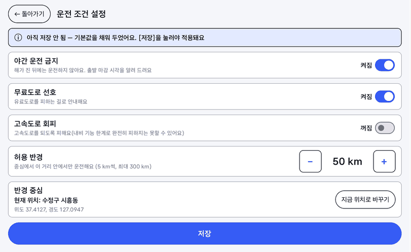
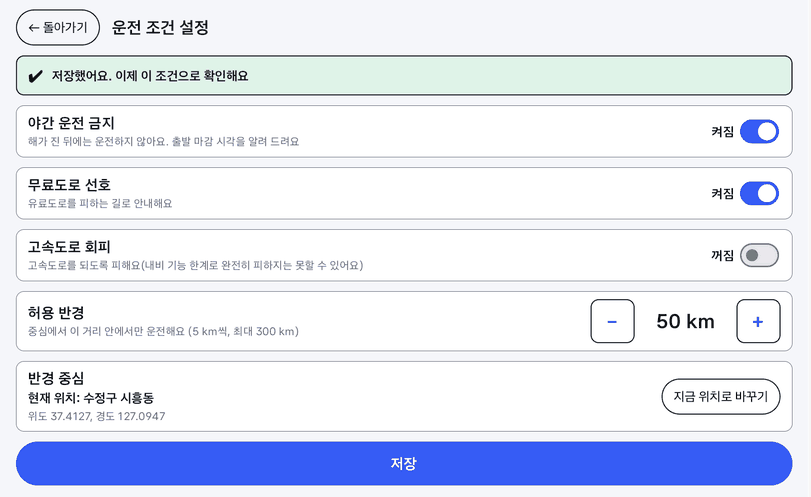

# 2번 '출발 전' 연동 안내 (`:departure-core` + NaviHelper 조회)

2번 파트(출발 전: 출발 마감 알림·허용 반경 확인·무료도로 확인)의 핵심 로직을 이 저장소에 넣고, 1번 Repository에 연결했다.
출발 확인 화면(UI)은 넣지 않았다(화면 방식 협의 전이라 상태(StateFlow)만 제공). **운전자 조건 설정 화면은 작업 #17에서 추가했다**(2.1절).

- 원본: 2번 저장소 `MyApplication/departure-core` (패키지 `com.pleos.departure.*`). 이 PR이 병합되기 전까지 원본은 2번 저장소다.
- 근거 문서(2번 저장소): `docs/pleos/api-notes/navi-route.md`, `eta-location.md`, `sdk-setup.md`, `navi-runtime-check.md`(에뮬레이터 2.1.0 / 내비 3.3.2 / NaviHelper SDK 3.0.5 실행 확인), `docs/pleos/integration/part1-gap-analysis.md`

## 1. 추가된 것

| 위치 | 내용 |
|---|---|
| `departure-core/` (신규 모듈) | 순수 Kotlin/JVM 모듈. Android·Pleos 의존성 없음(코루틴 + `java.time`만). 일몰 계산, 출발 마감, 반경 확인, 무료도로 확인, 확인 세션(`DepartureSession`). 단위 테스트 147건 |
| `app/.../data/repository/NaviHelperRepository(.kt / Impl.kt)` | **조회 계열 멤버 추가**(기존 멤버는 그대로): `currentDestination`, `currentRouteState`, `getDestinationInfo()`, `getRouteStateInfo()`, `requestTrip(...)`, `getCurrentLocation()`, `injectMockDestination()`, `injectMockRouteOption()`. 실제 NaviHelper SDK를 호출하고, 서비스 연결이 안 되면 `VehicleRepositoryImpl`처럼 Mock Fallback |
| `app/.../data/model/NaviModels.kt` | 모델 추가: `NaviLocation`, `NaviDestinationInfo`, `NaviMode`, `NaviRouteState`, `NaviTripInfo`, `NaviHelperException`(실패 사유 구분) |
| `app/.../departure/` (신규 패키지) | 2번 core 포트 ↔ 1번 Repository 어댑터, 조립 코드 `DriveProbeDeparture`, 변환 규칙 `DepartureMappers` |
| `app/src/test/.../departure/DepartureMappersTest.kt` | 변환 규칙 단위 테스트 16건(기존 `testImplementation(libs.junit)`만 사용) |
| `app/.../data/local/entity/DriverConditionEntity.kt`, `dao/DriverConditionDao.kt` (작업 #15) | 운전자 조건 Room 테이블 `driver_conditions`(단일 행, `updatedAt`·`isSynced` 포함). `AppDatabase` v1 → v2, `MIGRATION_1_2` |
| `app/.../departure/RoomDriverConditionRepository.kt`, `DriverConditionEntityMapper.kt` (작업 #15) | 2번 `DriverConditionRepository` 포트의 Room 구현 + Entity ↔ `DriverCondition` 변환. 단위 테스트 17건(`DriverConditionEntityMapperTest` 12, `RoomDriverConditionRepositoryTest` 5) |
| `app/src/androidTest/.../data/local/AppDatabaseMigrationTest.kt` (작업 #15) | v1 DB → v2 마이그레이션 계측 테스트(기존 데이터 유지 확인) |
| `DriveProbeApplication.departureFeature` | 진입점(lazy) |
| `app/.../departure/DriverConditionDefaults.kt`, `DriverConditionForm.kt`, `DriverConditionSettingsController.kt`, `DriverConditionSettingsViewModel.kt` (작업 #17) | 운전자 조건 설정 화면의 기본값(한 곳), 입력값·검증·저장 변환, 상태와 동작(Android 의존 없는 일반 클래스), AndroidViewModel 래퍼 |
| `app/.../ui/screen/DriverConditionSettingsScreen.kt` (작업 #17) | 운전자 조건 설정 화면(Compose). 2.1절 |
| `app/src/test/.../departure/DriverConditionFormTest.kt`, `DriverConditionSettingsControllerTest.kt` (작업 #17) | 설정 화면 로직 단위 테스트 20건(9 + 11) |

## 2. 사용법

```kotlin
// ViewModel(또는 화면 수명과 같은 범위)에서
val feature = DriveProbeApplication.instance.departureFeature
val session = feature.createSession(viewModelScope)      // 화면 하나에 세션 하나

// 상태 관찰: StateFlow<DepartureSessionState>
session.state.collect { state ->
    // state.outcome        : CheckOutcome.Checked(snapshot, recheck, tollToggleNotYetApplied) 또는 CheckOutcome.Failed, 첫 결과 전 null
    // state.loading / showLoadingIndicator (2초 넘으면 "확인 중" 표시)
    // state.drivingRestriction / controlsEnabled (false 면 조작 요소를 숨긴다)
}

// 명령 (메인 스레드에서 부른다)
session.onVisible()                        // 화면이 보이기 시작함(진입·백그라운드 복귀) → 확인 시작, 60초마다 갱신
session.onHidden()                         // 화면이 가려짐 → 주기 확인 멈춤
session.refresh()                          // 사용자 "다시 확인"
session.confirmTollAvoidanceTurnedOn()     // 사용자 "켰어요"(내비에서 유료도로 우회를 켰다고 알림)
session.resetSession()                     // 세션 기억을 지우고 다시 확인
```

- **세션에는 release(해제) 메서드가 없다.** 넘긴 `CoroutineScope`가 취소될 때만 멈춘다. 반드시 수명이 끝나는 범위(`viewModelScope`, `lifecycleScope`, Compose `rememberCoroutineScope()`)를 넘긴다. `GlobalScope`나 Application 범위를 넘기면 앱이 끝날 때까지 돈다.
- **스레드 가정**: 상태 갱신은 넘긴 scope 의 dispatcher 에서 일어난다(`viewModelScope`는 Main). 명령(`onVisible` 등)은 메인 스레드에서 부른다. 세션 내부 상태는 한 스레드에서만 바뀐다는 전제로 동기화하지 않는다.
- 한 번 계산만 필요하면 `feature.departureCheck` 등 유스케이스를 직접 호출해도 된다.
- 화면 문구(한국어)는 core 에 없다. `CheckOutcome.Checked.snapshot`(출발 마감·반경·경로 결과)을 화면 쪽에서 문구·아이콘으로 바꾼다. 2번 저장소의 `:departure-ui`(`DepartureDisplayMapper`)를 참고하거나 가져올 수 있다.
- 동작 수치(출발 여유 30분, 기본 반경 10km, 경고 임계값, 콜백 타임아웃 등)는 `DepartureConfig` 하나에 있다. 바꾸려면 `DriveProbeDeparture.createFeature(..., config = DepartureConfig().copy(...))`.
- **`createFeature`의 `driverConditionRepository` 인자는 필수다(작업 #15에서 기본값 제거 — 공개 시그니처 변경, 감독관 승인).** 인메모리 저장소가 조용히 쓰여 조건이 앱 재시작마다 사라지는 일을 막기 위해서다. 앱은 `RoomDriverConditionRepository`, 테스트는 `InMemoryDriverConditionRepository`를 넘긴다(호출처: `DriveProbeApplication`, `NaviHelperQuerySmokeTest`).

### 2.1 운전자 조건 설정 화면 (작업 #17)

| 기본값(저장된 조건이 없을 때) | 저장 후 |
|---|---|
|  |  |

- **들어가는 곳**: API 탐색 화면 머리(`CatalogHeader`) 오른쪽 끝의 [운전 조건 설정] 버튼 하나. 1번 화면 구성·스타일은 그대로 두고, `AppPage`에 `DRIVER_CONDITION_SETTINGS` 값을 하나 더해 기존 `SampleApp`의 `when (uiState.page)` 분기로 띄운다. [← 돌아가기] 또는 시스템 뒤로 가기로 API 탐색 화면(이전 상태 그대로)에 돌아간다.
- **보여 주는 값**: 저장된 조건이 있으면 그 값. 없으면 기본값(`DriverConditionDefaults` 한 곳에만 있음): 야간 운전 금지 켬, 무료도로 선호 켬, 고속도로 회피 끔, 허용 반경 50 km, 반경 중심 = 화면을 열 때 읽은 `NaviHelperRepository.getCurrentLocation()`.
  - 현재 위치를 읽지 못하거나 Mock 값(내비 미연결)이면 중심을 비우고 "현재 위치를 읽지 못했어요 — 반경 확인은 중심이 있어야 동작해요" + [다시 시도].
  - 저장된 반경이 null(앱 기본 반경 사용)이면 `DepartureConfig.defaultAllowedRadiusMeters`(10 km)를 보여 주고, 이 화면에서 저장하면 그 값이 명시적으로 저장된다.
- **기본값은 [저장]을 누르기 전에는 DB에 쓰지 않는다**(저장 안 됨 = 조건 미설정, 계약 §8 D-9). 그동안 화면 맨 위에 "아직 저장 안 됨 — 기본값을 채워 두었어요" 안내가 뜬다. 저장 뒤 값을 바꾸면 "바꾼 내용이 아직 저장 안 됨".
- **검증**(계약 §4.2): 반경 > 0, 상한 300 km(`DriverConditionDefaults.MAX_RADIUS_KM`, 넘으면 "300 km 이하로 정해 주세요"), 중심 위도·경도는 둘 다 있거나 둘 다 없거나 + 범위. 반경은 [−]/[+] 5 km 눈금(5~300 km)이라 화면 조작으로는 오류가 잘 나지 않고, 저장된 이상값(예: 500 km)을 불러왔을 때 저장을 막는다. 중심 없이 저장하는 것은 허용(반경 확인 "확인 불가").
- **주행 중**: `VehicleRepository.uxRestriction` → `DepartureMappers.drivingRestriction`이 RESTRICTED면 모든 입력·저장·위치 다시 읽기를 막고 "주행 중에는 설정을 바꿀 수 없어요". UNKNOWN(첫 값 전)은 `treatUnknownDrivingAsRestricted`(기본 true)에 따라 "차량 상태를 확인하는 중이라 아직 바꿀 수 없어요".
- **화면 기준**: 본문 26sp 이상(제목 30~34sp), 행 전체가 눌리는 104dp 높이 켜기/끄기 + "켜짐/꺼짐" 글자, 88dp [−]/[+]·[저장] 버튼, 진한 글자 + 테두리. 상태 안내는 색 + 기호(ⓘ ✔ ✎ ✕ ⛔) + 문구로 한 줄만 보여 준다.
- 에뮬레이터 확인(2026-11-10, Pleos Connect v2.1.0, Park): 첫 진입 시 기본값 + 현재 위치(수정구 시흥동, 37.4127/127.0947) 표시 → [저장] → "저장했어요" → 앱 강제 종료 후 다시 들어가도 "저장된 조건이에요"(Room 유지 확인). 위 캡처가 그 화면이다.
- 저장소는 `DriveProbeApplication.driverConditionRepository`(Room, 작업 #15) — `departureFeature`와 같은 인스턴스를 쓴다. 설정 화면에서 저장하면 출발 확인이 다음 확인부터 그 조건을 쓴다.

## 3. 1번 파일에 한 변경 (추가 위주)

| 파일 | 변경 | 종류 |
|---|---|---|
| `settings.gradle.kts` | `include(":departure-core")` 1줄 | 추가 |
| `build.gradle.kts`(루트) | `alias(libs.plugins.kotlin.jvm) apply false` 1줄 | 추가 |
| `gradle/libs.versions.toml` | `kotlinxCoroutines = "1.9.0"`, `naviHelperSdk = "3.0.5"`, 라이브러리 `navihelper-sdk`·`kotlinx-coroutines-core`·`kotlinx-coroutines-test`, 플러그인 `kotlin-jvm` | 추가 |
| `app/build.gradle.kts` | `implementation(libs.navihelper.sdk)`, `implementation(project(":departure-core"))` 추가, **`minSdk 23 → 28`** | 추가 + 값 변경 1곳 |
| `app/src/main/AndroidManifest.xml` | `pleos.car.permission.NAVI_ROUTE` 1개 | 추가 |
| `data/model/NaviModels.kt` | 파일 끝에 모델 6개 | 추가 |
| `data/repository/NaviHelperRepository.kt` | 인터페이스 끝에 멤버 8개 | 추가 |
| `data/repository/NaviHelperRepositoryImpl.kt` | 생성자에 `context: Context? = null, enableMockFallback: Boolean = true`(기본값이라 기존 `NaviHelperRepositoryImpl()` 호출도 그대로 컴파일됨), 클래스 끝에 조회 구현 + `releaseNaviHelper()` | 추가(기존 메서드·목업 변경 없음) |
| `DriveProbeApplication.kt` | `val departureFeature by lazy { ... }` 추가(작업 #15부터 `RoomDriverConditionRepository(appDatabase.driverConditionDao(), clock)`를 넘김), `NaviHelperRepositoryImpl()` → `NaviHelperRepositoryImpl(this)`(SDK 연결에 context 필요) | 추가 + 인자 1개 |
| `data/local/AppDatabase.kt` (작업 #15) | 엔티티 `DriverConditionEntity`·`driverConditionDao()` 추가, `version 1 → 2`, `MIGRATION_1_2` + `.addMigrations(MIGRATION_1_2)`. `fallbackToDestructiveMigration()`은 그대로 | 추가 + 값 변경 1곳 |
| `data/repository/NaviHelperRepository(.kt / Impl.kt)` `searchConditionAdaptedRoute` (작업 #15) | KDoc만 추가(실측 한계 명시). 시그니처·동작 변경 없음 | 주석 |
| `app/build.gradle.kts` (작업 #14b) | android 블록에 `useLibrary("android.car")` 1줄(AGP 8.8.2 DSL 그대로 동작, compileSdk 35의 `optional/android.car.jar` 스텁 연결. APK에 포함되지 않음) | 추가 |
| `app/src/main/AndroidManifest.xml` (작업 #14b) | `<application>` 안에 `<uses-library android:name="android.car" android:required="false"/>`. 권한 추가 없음 | 추가 |
| `data/model/VehicleModels.kt` (작업 #14b) | 파일 끝에 `UxRestrictionSource`(CAR_SERVICE/UNAVAILABLE/MOCK), `UxRestrictionState` | 추가 |
| `data/repository/VehicleRepository.kt` (작업 #14b) | `val uxRestriction: StateFlow<UxRestrictionState?>`, `fun injectMockUxRestriction(...)`. 기존 `drivingState`·`setDrivingState` 그대로 | 추가 |
| `data/repository/VehicleRepositoryImpl.kt` + 새 파일 `CarUxRestrictionsMonitor.kt` (작업 #14b) | `initialize()` 맨 앞에서 CarUxRestrictions 구독 시작, `release()`에서 해제. android.car 호출은 `CarUxRestrictionsMonitor`에만 둠 | 추가 |

| `ui/data/MainUiState.kt` (작업 #17) | `AppPage`에 `DRIVER_CONDITION_SETTINGS` 1개 | 추가 |
| `MainViewModel.kt` (작업 #17) | `showDriverConditionSettings()`·`closeDriverConditionSettings()`(`page`만 바꿈, 다른 상태 유지) | 추가 |
| `ui/screen/SampleApp.kt` (작업 #17) | 인자 `onOpenDriverCondition`·`driverConditionSettings`(둘 다 기본값 있음), `when (uiState.page)`에 분기 1개 | 추가 |
| `ui/screen/ApiCatalogScreen.kt` (작업 #17) | 인자 `onOpenDriverCondition`(기본값 있음)을 `CatalogHeader`까지 전달, 머리 오른쪽 끝에 [운전 조건 설정] 버튼(`DriverConditionEntryButton`) 1개. 기존 배치·스타일 변경 없음 | 추가 |
| `MainActivity.kt` (작업 #17) | `DriverConditionSettingsViewModel by viewModels()`, `SampleApp`에 위 두 인자 전달 | 추가 |
| `DriveProbeApplication.kt` (작업 #17) | `departureConfig`·`driverConditionRepository`(lazy)로 꺼내 `departureFeature`와 설정 화면이 같이 씀. 동작 변경 없음 | 정리 |

**건드리지 않은 것**: `searchConditionAdaptedRoute`(KDoc 외)·`guideToNearestRestArea`·`startNavigation`·`stopNavigation`·`injectMockRestAreas`·`setMockLocation`, `VehicleRepository(Impl)`의 기존 멤버(Vehicle SDK·HVAC·창문·`drivingState`·Mock 주입 — 작업 #14b는 멤버 추가만), Room 기존 엔티티·DAO(`ReactionScore*`·`InterventionHistory*`), 기존 화면의 배치·스타일·테마(작업 #17은 위 표의 진입 버튼·분기만 추가), 다른 빌드 설정(AGP 8.8.2 / Kotlin 2.0.0 / compileSdk 35 / JVM 17 / Compose BOM).

### minSdk 23 → 28 이유
1. Pleos 요구: "API 28 이상 — 차량 사이버 보안 요건(사이닝 키 로테이션·리니지 지원)" (Pleos Connect Emulator 설치 및 실행 문서, 2번 `api-notes/sdk-setup.md`).
2. `:departure-core`는 `java.time`(Duration·Instant·ZoneId)을 desugaring 없이 쓴다 → API 26 이상 필요.
- 참고: NaviHelper aar 자체 매니페스트는 minSdk 23이라 병합 오류는 나지 않는다. 올리는 이유는 위 두 가지다.

### 권한
- `NAVI_ROUTE`만 선언했다: `getDestinationInfo`·`getRouteStateInfo`·`getCurrentLocationInfo`·`requestTrip`용(보호 수준 normal, 설치 시 자동 허용).
- `NAVI_ROUTE_SEARCH`(requestRoute·cancelRoute·changeRouteOption 등)는 SDK로 부르는 곳이 없어 넣지 않았다. Pleos 정책: 승인되지 않은 권한 선언은 심사 탈락 사유 → 필요한 권한만 선언. 1번이 `searchConditionAdaptedRoute`를 실제 SDK로 구현할 때 함께 추가하면 된다.
- 예외: `app/src/debug/AndroidManifest.xml`(debug 빌드 전용)에 `NAVI_ROUTE_SEARCH`를 선언했다. 에뮬레이터 스모크 테스트(8절)가 테스트 안에서 목적지를 설정·취소하기 위해서다. 계측 테스트는 앱 uid로 돌기 때문에 androidTest 매니페스트로는 안 된다(미선언 시 `SecurityException: Permission [pleos.car.permission.NAVI_ROUTE_SEARCH] is required` 실측). release 매니페스트에는 들어가지 않는다.

## 4. NaviHelperRepository 조회 계열 동작

- **NaviHelper 인스턴스·리스너는 `NaviHelperRepositoryImpl` 하나만 가진다.** 콜백에 요청 ID가 없어서 두 곳에서 등록하면 응답이 섞인다. 다른 기능도 이 Repository 를 거쳐 주세요.
- 연결: 조회 메서드를 처음 부를 때 `initialize(onConnected, onFailed)` → `addListener`. 실패하면 30초 동안 재시도하지 않고 Mock Fallback(`enableMockFallback = true`) 또는 `NaviHelperException(UNAVAILABLE)`.
  - 연결된 뒤 `onFailed`가 늦게 오거나 SDK 호출이 예외를 던지면(권한 예외 제외) 연결이 끊긴 것으로 보고 다음 조회에서 다시 연결한다. SDK 문서에 연결 끊김 전용 콜백이 없어서, 서비스가 조용히 죽으면 감지하지 못하고 조회가 타임아웃(5·10초)으로 끝날 수 있다.
- 한 번에 한 요청(Mutex), SDK 호출은 메인 스레드, 콜백 대기 제한: 목적지·경로 상태·위치 5초, requestTrip 10초(실측 0.02~1.0초).
- 목적지 없음: SDK는 오류 대신 좌표 (0,0)의 0 값 객체를 준다 → `success(null)`. **경로 교체 중(최대 약 19초, 탐색 실패 시 무기한)에도 똑같은 0 값**이 와서 구분할 수 없다. 2번 세션이 5초 × 6회 재확인으로 처리한다.
- `tollFare`: `onRouteStarted`에서만 오고 다시 조회할 수 없다 → 받아 둔다. `onRouteCancelled`, 리스너 (재)등록, 다른 목적지 좌표가 들어오면 버린다. `DestinationInfo.tollFare`는 항상 0이라 쓰지 않는다.
- `requestTrip`: 안내를 시작하지 않는다. 결과는 내비가 그 순간 쓰는 "유료도로 우회" 설정을 따르므로, 안내 중이면 같은 시점 `routeOption`을 함께 돌려준다.
- 실패 사유: `NaviHelperException.reason` = `UNAVAILABLE` / `TIMEOUT` / `SERVICE_ERROR` / `PERMISSION_DENIED`.
- **미연결 시 목적지**: Mock 목적지(`injectMockDestination`)를 넣지 않았다면 `success(null)`("목적지 없음")이 아니라 `NaviHelperException(UNAVAILABLE)` 실패를 돌려준다. 목적지를 모르는 상태를 "목적지 없음"으로 지어내지 않기 위해서다. 그래서 Mock 으로 "목적지 없음"을 흉내 낼 수는 없다.
- Mock Fallback 값은 `currentDestination`·`currentRouteState`에 넣지 않는다(이 두 상태는 실제 SDK 값만).
- **늦은 콜백 한계**: 콜백에 요청 ID가 없어, 타임아웃 뒤 늦게 온 콜백이나 대기 중 외부 사건으로 온 푸시(예: 사람이 취소해서 온 0 값 목적지)가 다음 같은 종류 요청의 응답으로 쓰일 수 있다. 2번 세션의 재확인(5초 × 6회)과 60초 주기 갱신이 보완한다.
- Mock 값에는 `isMock = true`가 붙는다. 2번 어댑터는 기본 설정에서 Mock 값을 쓰지 않는다(지어낸 위치·ETA로 판정하면 거짓 안내). 서비스 없는 환경에서 시연할 때만 `createFeature(..., acceptMockNaviValues = true)`.

### 주행 중 UX 제한 — `VehicleRepository.uxRestriction` (작업 #14b)
- 출처: AAOS `CarUxRestrictionsManager`(Pleos SDK 아님). Pleos 주행 규제 개발 가이드가 "플랫폼이 제공하는 CarUxRestrictions 상태를 기준으로" UX 제한을 하라고 요구한다 → 3·4번 화면도 이 값을 쓰면 된다.
- 동작: `initialize()`에서 `Car.createCar(context, 메인 Handler, CAR_WAIT_TIMEOUT_DO_NOT_WAIT, 수명주기 리스너)`(연결을 기다리지 않음 — 메인 스레드 ANR 방지, 재작업 1회차) → 연결되면 수명주기 리스너 `ready=true`에서 `getCarManager(CAR_UX_RESTRICTION_SERVICE)` → **`getCurrentCarUxRestrictions()`로 현재 값 1회 읽기**(리스너 등록 직후 초기값 콜백이 오지 않음, 실측) → `registerListener`로 변경 수신. `release()`에서 `unregisterListener()` + `disconnect()`.
- 값: `null` = 아직 못 읽음. car service 값은 `source = CAR_SERVICE`. 에뮬레이터 실측 Park = `false / 0x0`, Drive = `true / 0x50`(변경 후 약 16~36ms에 리스너 호출).
- 실패(자동차 아닌 기기, android.car 클래스 없음, manager null, 예외, 연결 끊김 `ready=false`) → `source = UNAVAILABLE`, `requiresDistractionOptimization = true`, `0x1ff`. **`enableMockFallback`이어도 "제한 없음" Mock 값을 지어내지 않는다.** 2번 어댑터는 UNAVAILABLE을 설정과 무관하게 RESTRICTED로 본다.
- 연결 전(첫 값 전)에는 `uxRestriction = null` → 2번 어댑터는 UNKNOWN(기본 설정에서 제한).
- `injectMockUxRestriction(requiresDO, active)` → `source = MOCK`. 실제 값이 바뀌면 덮어써진다.
- 권한: 선언하지 않았다(에뮬레이터에서는 권한 없이 동작, 실측). 실차 이미지도 같은지는 [미확인].
- 근거: 2번 저장소 `docs/pleos/api-notes/vehicle-state.md` §13, `evidence/2026-11-10/task14/`.

## 5. 2번 포트 ↔ 1번 Repository 대응

| 2번 포트 (`com.pleos.departure.port`) | 1번 Repository | 비고 |
|---|---|---|
| `VehicleRepository.observeDrivingRestriction()` | `VehicleRepository.uxRestriction` (작업 #14b부터. `drivingState`는 쓰지 않음) | CAR_SERVICE: DO true → RESTRICTED, false → UNRESTRICTED. UNAVAILABLE(연결 실패) → RESTRICTED. null(첫 값 전) → UNKNOWN. MOCK: true → RESTRICTED, false → UNKNOWN(지어낸 값으로 조작을 열지 않음) |
| `NaviRepository.getDestination()` | `NaviHelperRepository.getDestinationInfo()` | null·(0,0) → NotSet, displayName = name → address → "내비 목적지" |
| `NaviRepository.getRouteState()` | `getRouteStateInfo()` | ROUTE/SIMULATION_GUIDING → Guiding, SAFE_GUIDING → NotGuiding, NOT_WORKING → 확인 불가 |
| `NaviRepository.requestTrip(place)` | `requestTrip(lat, lng, poiName, poiId)` | eta(남은 초) → Duration, 출처 SDK_MEASURED |
| `NaviRepository.getCurrentLocation()` | `getCurrentLocation()` | (0,0) → 확인 불가 |
| `NaviRepository.observeRemainingTrip()` | `currentDestination` | 2번 core는 지금 쓰지 않음 |
| `DriverConditionRepository` | `AppDatabase.driverConditionDao()` → `RoomDriverConditionRepository` | 아래 한계 2. 인메모리 구현(`InMemoryDriverConditionRepository`)은 테스트 전용으로 남김 |
| `TtsRepository` / `SttRepository` | (없음) → 항상 Unavailable | 2번은 TTS/STT를 쓰지 않음 |

## 6. 알려진 한계

1. **주행 규제는 CarUxRestrictions 기준이다(작업 #14b에서 해결 — 이전에는 `drivingState` 매핑 때문에 조작이 늘 숨겨졌다).** 주차 중이면 UNRESTRICTED가 나와 조작이 보인다. 남은 한계:
   - 연결 실패(UNAVAILABLE)는 설정과 무관하게 RESTRICTED. 첫 값 전(null)은 UNKNOWN → 기본 설정(`treatUnknownDrivingAsRestricted = true`)에서 조작이 숨겨진다(의도된 안전 쪽 동작). `false`로 바꾸면 연결 대기 중의 짧은 순간 조작이 보일 수 있다.
   - car service 미연결·종료 상태, 자동차가 아닌 기기, android.car 클래스가 없는 기기의 동작은 시험하지 못했다 [미확인]. 코드는 모두 `Throwable` catch → 제한 쪽.
   - `createCar`는 연결을 기다리지 않는다(`CAR_WAIT_TIMEOUT_DO_NOT_WAIT`). 에뮬레이터 실측: 테스트에서 `initialize()` 18ms, 첫 값까지 2~33ms. car service가 늦게 뜨는 상황은 만들 수 없어 그때 수명주기 리스너가 나중에 오는지는 [미확인](AOSP 지식상 연결 시 호출). `createCar`가 null을 돌려주면 재시도하지 않고 null(UNKNOWN)로 남는다.
   - 참고(1번 기존 동작): 앱 콜드 스타트 약 9.3~9.5초(`am start -W`) 중 Vehicle SDK `initialize`(기존 코드)가 메인 스레드에서 약 2.8초 걸렸다(logcat `[Pleos][SDK]Vehicle: initialize` 16:04:41.976 → `hasPropertyIdCount` 16:04:44.787). CarUxRestrictions 쪽은 그 앞 0.3초 안에 끝났다.
   - 리스너 콜백 스레드는 확인하지 않았다 [미확인]. 값은 `MutableStateFlow`에 넣기만 하므로 스레드와 무관하다.
   - Moving(속도 > 0) 상태 값은 에뮬레이터에서 만들지 못했다 [미확인]. Park/Drive만 실측.
   - Drive 전환은 Virtual Console(브라우저) 조작이 필요해 자동 테스트(8절)에는 Park만 있다. Drive = `true/0x50`은 작업 #14a 프로브로 실측.
2. **운전자 조건은 Room 에 저장된다(작업 #15, 서버 동기화는 아직 없음).** 앱을 다시 시작해도 남는다. 처음 설치 시에는 행이 없어 "조건 미설정"이라 판정을 하지 않는다. 운전 조건 설정 화면(2.1절, 작업 #17)에서 [저장]을 눌러야 조건이 생긴다.
   - 테이블 `driver_conditions`: 단일 행(`id = 1`). 집합은 enum 이름을 쉼표로 이은 문자열(오름차순), 반경 중심은 위도·경도 두 열(둘 다 null 이거나 둘 다 값), `updatedAt`(epoch ms), `isSynced`. 필드는 2번 `DriverCondition`·`docs/pleos/contracts/driver-condition-api.md` §4 그대로.
   - 포트 규칙(계약 §5.4): 행 없음 → `observeCondition()` = `Available(null)`, `getCondition()` = `Unavailable(NO_DATA)`. 해제 저장(빈 조건) → 행이 남아 `Available(DriverCondition())`. DB 오류·모르는 enum·범위 밖 값 → `Unavailable(SERVICE_ERROR)`(건너뛰거나 null 로 내보내지 않음).
   - **DB 버전 1 → 2.** `MIGRATION_1_2`는 `driver_conditions` 테이블만 만든다 → 기존 `reaction_scores`·`intervention_histories` 기록은 유지된다. `fallbackToDestructiveMigration()`은 그대로라 **마이그레이션이 없는 버전 조합(예: 다음에 v3를 만들면서 2→3 마이그레이션을 빠뜨림)에서는 전부 지워진다.** 스키마를 바꿀 때는 `Migration`을 추가하고, SQL은 빌드 후 `app/build/generated/ksp/debug/java/.../AppDatabase_Impl.java`의 `CREATE TABLE`과 같게 맞춘다(`AppDatabaseMigrationTest`가 검증).
   - 서버 동기화(GET/PUT `/v1/drivers/me/driver-condition`)는 1번 몫이다. 붙일 때 `RoomDriverConditionRepository`의 `TODO(1번-동기화)`(미전송 우선, `markAsSynced(updatedAt)`, 404 + `CONDITION_NOT_SET`만 미설정)를 참고한다.
   - 1번 `DrivingConditions`(최고속도·편안한 경로 포함)와 2번 `DriverCondition`(무료도로 선호·허용 반경 포함)은 아직 별개다. 운전자 조건의 원본은 이 테이블(2번 모델)로 한다(사용자 결정, 작업 #15). `DrivingConditions`는 `searchConditionAdaptedRoute` 인자로만 남아 있다.
3. **1번 `searchConditionAdaptedRoute`는 실측 결과와 맞지 않는다**(동작은 수정하지 않고 작업 #15에서 아래 내용을 인터페이스·구현 KDoc에 적었다. 2번 어댑터는 부르지 않는다):
   1. 경로 옵션이 적용되지 않는다. `requestRoute(RouteInfo(routeOption = FREE))`, `changeRouteOption(FREE)` 모두 무시됐다(적용 옵션 RECOMMENDED 그대로, 통행료 700원 그대로, `onRouteOptionChanged` 없음). 무료도로가 되는 방법은 **사람이 내비 "경로 설정"에서 "유료도로 우회"를 켜는 것**뿐이었고, 확인은 `getRouteStateInfo().routeOption == FREE`로 한다.
   2. 고속도로 회피 옵션은 SDK에 없다(RouteOption 7개, 회피 값 없음). "유료도로 우회"를 켜도 통행료 없는 고속도로가 남았다. `avoidHighways`·`maxSpeedLimitKmh`는 경로로 보장할 수 없다.
   3. 안내 중 `requestRoute`는 확인 없이 기존 안내를 덮어쓴다(약 7초 뒤 새 안내 시작). 출발 전 "탐색"용으로 부르면 사용자가 설정한 목적지와 유료도로 우회 설정이 사라질 수 있다.
   4. `requestRoute`는 호출 즉시 안내를 시작한다. "탐색 후 `startNavigation(routeId)`" 2단계에 해당하는 SDK 기능이 없다(경로 ID도 없음). 안내 없이 ETA만 보려면 `requestTrip`.
   5. `destination: String`으로는 요청을 만들 수 없다. `RouteInfo`는 위도·경도가 필수다.
   6. `RouteInfo.containsHighway`, `isNightDrivingExpected`는 SDK가 주는 값이 아니라 화면에 쓰면 거짓 안내가 된다. 야간(일몰) 판정은 2번 core(`DepartureDeadlineUseCase`)가 일몰 + ETA로 한다.
   - 원문: 2번 저장소 `docs/pleos/integration/part1-gap-analysis.md` 8절 B.
4. 에뮬레이터 내비 위치는 기본 위치(성남 수정구)에 고정되고 `geo fix`/`geo nmea`를 따르지 않는다. 시연 수치를 원하는 값으로 만들기 어렵다.
5. NaviHelper 조회 계열은 에뮬레이터 스모크 테스트로 확인했다(8절). 실차·다른 내비 버전, 경로 교체 중·탐색 실패 경로는 이 테스트에서 다루지 않는다.
6. `NaviHelperRepositoryImpl.releaseNaviHelper()`는 어디서도 부르지 않는다(`onTerminate`는 실기기에서 호출되지 않음). 필요하면 1번이 수명 관리 위치를 정한다. 부를 때는 메인 스레드에서, 진행 중인 조회가 없을 때 부른다(Mutex 밖에서 실행됨).
7. 연결된 뒤 서비스가 조용히 죽으면(끊김 콜백 없음) 감지하지 못해 조회가 타임아웃으로 끝날 수 있다. `onFailed`가 늦게 오거나 SDK 호출이 예외를 던질 때만 연결을 끊고 다시 연결한다.

## 7. 2번 core 를 고칠 때
- 원본은 병합 전까지 2번 저장소(`MyApplication/departure-core`)다. 이 저장소의 `departure-core/`를 직접 고치면 2번 저장소에도 반영해야 한다.
- 이식하면서 바꾼 core 코드: `model/Trip.kt` `TripEstimate.isFresh` 한 줄(`Duration.isPositive`는 Java 18 / Android API 34부터라 JDK 17·minSdk 28에서 쓸 수 없어 비교 연산으로 바꿈. 동작 동일). 2번 저장소에도 같은 수정이 역반영되어 지금 두 저장소의 core 는 같다.

## 8. 검증 (에뮬레이터 스모크 테스트, 2026-11-10)

- 테스트: `app/src/androidTest/java/ai/pleos/playground/sample/vehicle/departure/NaviHelperQuerySmokeTest.kt` (logcat 태그 `NaviQuerySmoke`)
- 실행: 에뮬레이터(Pleos Connect v2.1.0)와 내비 앱이 떠 있는 상태에서 `./gradlew :app:connectedDebugAndroidTest`
  - **실제 내비 상태를 바꾼다**(서울역 목적지 설정 → 끝에 `cancelRoute`로 취소). 개발 기기·에뮬레이터에서만 돌린다.
- 결과: 2회 연속 전 항목 통과(실패 0건). 작업 #15 이후 재실행(2026-11-10): `NaviHelperQuerySmokeTest`·`AppDatabaseMigrationTest` 2건 통과. 관측값:

| 항목 | 결과 | 관측값 |
|---|---|---|
| 1. 목적지 없음 | 통과 | `getDestinationInfo` = `success(null)`, `getRouteStateInfo` = `SAFE_GUIDING`/`RECOMMENDED`, `isMock=false` |
| 2. 안내 시작 대기 | 통과 | `requestRoute(서울역)` 후 약 10.9초에 `ROUTE_GUIDING` + 목적지 확인 |
| 2. 목적지 | 통과 | (37.5547, 126.9707), name=서울역, address=용산구 동자동, 23,000m / 2,700초, `isMock=false` |
| 2. 경로 상태 | 통과 | `ROUTE_GUIDING`, `routeOption=RECOMMENDED`, `tollFare=700`(`onRouteStarted` 값과 같음) |
| 2. requestTrip | 통과 | 23,799m, eta 2,745~2,763초, `routeOption=RECOMMENDED` |
| 2. 현재 위치 | 통과 | (37.4127212, 127.094681) 수정구 시흥동, `isMock=false` |
| 3. 어댑터 경유 출발 전 확인 | 통과 | `Checked`: 목적지 Present(서울역), 마감 `Deadline`(CAUTION, 일몰 17:25 기준 마감 16:00, ETA 출처 ESTIMATED — 무료도로 선호 + RECOMMENDED 보정), 반경 `Checked`(19.2km, 50km 안), 경로 `NeedsUserAction[TURN_ON_TOLL_AVOIDANCE]` |
| 4. 정리 | 통과 | `cancelRoute` → `onRouteCancelled` 0.3초, 이후 목적지 `success(null)`, `SAFE_GUIDING` |

- 부수 관측: 테스트 전용 NaviHelper 와 `NaviHelperRepositoryImpl` 의 리스너가 **둘 다** `onRouteStarted`를 받았다. 푸시 콜백은 등록된 모든 클라이언트에 간다 → 4절 "인스턴스 하나만" 원칙의 근거.
- 3번은 Application 의 `departureFeature` 대신 같은 조립 함수 `DriveProbeDeparture.createFeature`에 테스트의 Repository 와 운전자 조건을 넘겨 만든다(앱 쪽 Repository 로 두 번째 연결을 만들지 않기 위해, 그리고 인메모리 조건이 비어 있으면 `ConditionNotSet`으로 끝나기 때문).
- 로그 발췌는 2번 저장소 `docs/pleos/api-notes/evidence/2026-11-10/task13/`.

### 8.1 주행 규제 스모크 테스트 (작업 #14b, 2026-11-10)
- 테스트: `app/src/androidTest/java/ai/pleos/playground/sample/vehicle/departure/UxRestrictionSmokeTest.kt` (logcat 태그 `UxRestrictionSmoke`). 전제: 에뮬레이터 기어 **Park**(`dumpsys car_service` `Current Driving State: 0`).
- 결과: 통과. `uxRestriction = UxRestrictionState(requiresDistractionOptimization=false, activeRestrictions=0, source=CAR_SERVICE)`, 어댑터 `observeDrivingRestriction().first() = UNRESTRICTED`. 같은 실행에서 `NaviHelperQuerySmokeTest`·`AppDatabaseMigrationTest` 포함 3건 모두 통과.
- 재작업 1회차(`DO_NOT_WAIT` 전환 후): `park_readsCarServiceValue_andAdapterReportsUnrestricted`(initialize 18ms, 첫 값 대기 2ms, 어댑터 UNRESTRICTED), 신규 `releaseThenInitialize_resubscribes`(release → Mock 덮어쓰기 → 재 initialize 후 CAR_SERVICE false 값으로 복귀 — `unregisterListener()`·`disconnect()` 후 재연결 확인) 통과. 전체 4건 실패 0.
- Drive는 자동 테스트에 없음 [테스트 미확인, 작업 #14a 프로브로 실측].
